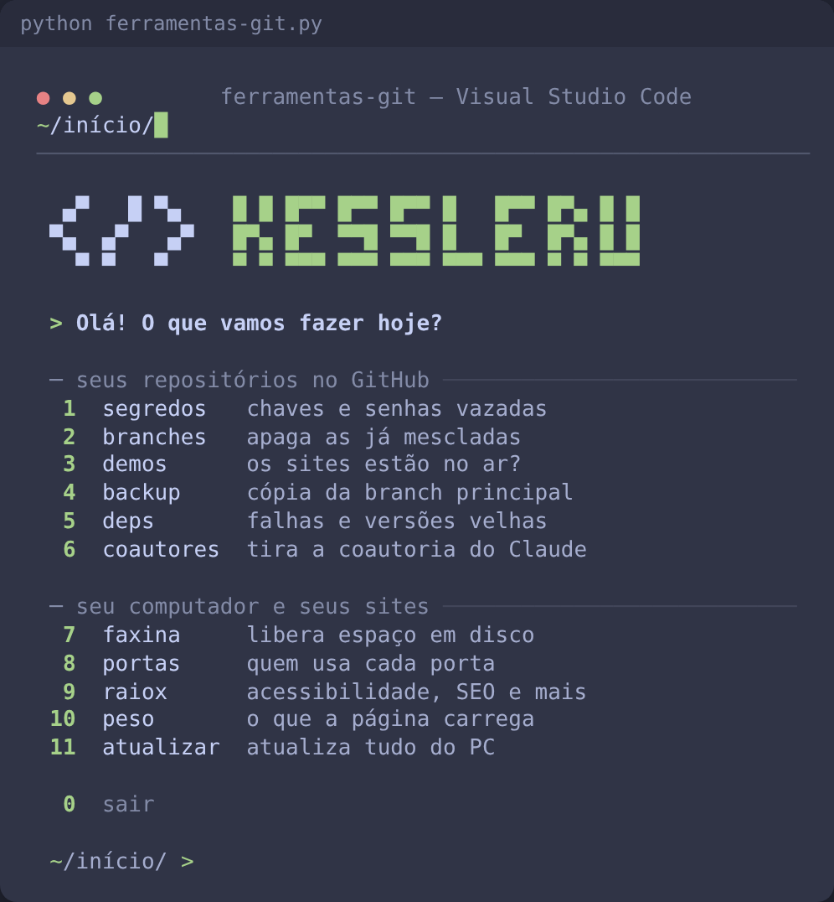
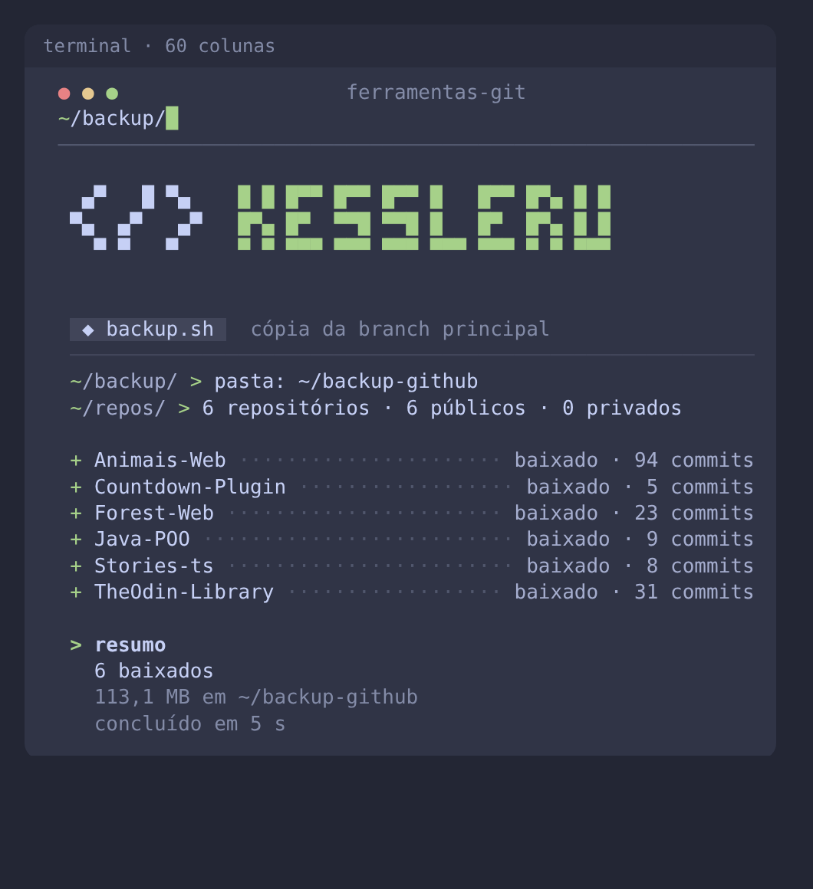
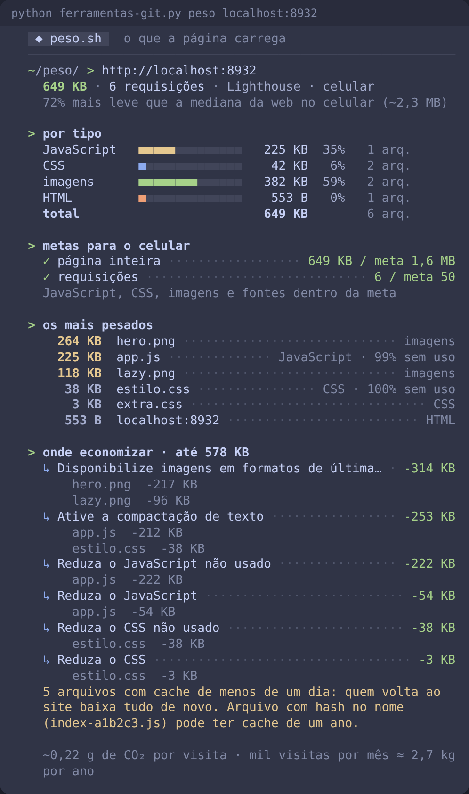

<div align="center">

 KESSLERU em pixels e a lista das onze ferramentas, no estilo neofetch" width="100%">

**Onze ferramentas num arquivo só: seis cuidam dos seus repositórios no GitHub e cinco cuidam do seu computador e dos seus sites.**

[](https://www.python.org/downloads/)
[](ferramentas-git.py)
[](#funciona-em-qualquer-terminal)

 KESSLERU em blocos e as onze ferramentas em dois grupos, GitHub e computador" width="520">

</div>

## Rodando

Precisa de **Python 3.8+**. Nada para instalar com pip.

```bash
python ferramentas-git.py                  # abre o menu
python ferramentas-git.py segredos         # ou vai direto numa ferramenta
python ferramentas-git.py raiox meusite.com.br
```

A parte do GitHub também usa **git** e **curl**. Na primeira vez ela procura seu login sozinha: a variável `GH_TOKEN`, o `gh`, ou o login que o git já guarda. Se não achar, pede um token (tipo *classic*, com `repo` e `workflow`) e não mostra o que você digita.

## Parte 1 · seus repositórios no GitHub

| Comando | O que faz | Altera alguma coisa? |
| --- | --- | --- |
| `segredos` | Varre o histórico inteiro atrás de chaves, tokens e senhas commitadas sem querer | Não |
| `branches` | Lista as branches já mescladas e apaga as que podem sair | Só depois do seu **SIM** |
| `demos` | Abre o link de demo de cada repositório e avisa quem saiu do ar | Não (oferece preencher o campo "site") |
| `backup` | Baixa e atualiza a branch principal de todos numa pasta | Só a sua pasta local |
| `deps` | Vulnerabilidades e dependências velhas dos projetos JavaScript, sem precisar de Node | Não |
| `coautores` | Tira a coautoria do Claude do histórico | Só depois do seu **SIM** |

<details>
<summary><b>O que cada uma faz por dentro</b></summary>

- **segredos**: lê cada versão de cada arquivo que já existiu, em todas as branches, e procura mais de 20 tipos de chave (GitHub, AWS, OpenAI, Anthropic, Stripe, Discord, Mercado Pago, chave privada, endereço de banco com senha…). Chave em teste, exemplo ou documentação aparece rebaixada, com o motivo. JWT é aberto para saber se é a `service_role` do Supabase (grave) ou a `anon` (pública). Falso positivo vai para `~/.ferramentas-git/segredos-ignorados.txt`.
- **branches**: compara cada branch com a principal e com os PRs. Só marca para apagar a que já está inteira na principal, ou cujo PR foi mesclado sem commits depois. Guarda o que apagou e desfaz com `--restaurar`. No fim, oferece ligar o "apagar branch após o merge" do GitHub.
- **demos**: pega o link do campo "site", do README e do GitHub Pages, abre cada um e reconhece página de erro disfarçada (deploy apagado da Vercel, Pages desligado, app suspenso no Render/Heroku).
- **backup**: clona só a branch principal e, nas próximas vezes, só puxa o que mudou. Se o histórico foi reescrito no GitHub, guarda a cópia velha em `.antigos` antes de baixar de novo; se você mexeu nos arquivos do backup, não atropela. Mantém um `INDICE.md` com o último commit de cada repositório.
- **deps**: lê `package-lock.json`, `pnpm-lock.yaml` ou `yarn.lock` direto do GitHub e consulta a mesma base de vulnerabilidades do `npm audit`, contando por pacote como ele. Mostra também o que está atrás de versão major e o que foi descontinuado.
- **coautores**: remove `Co-Authored-By: Claude`, `Claude-Session` e "Generated with Claude Code" das mensagens, e põe você como autor onde o Claude aparecia. Mesmos arquivos, datas e quantidade de commits; confere isso antes de enviar e guarda um backup de cada repositório.

</details>

<div align="center">

</div>

## Parte 2 · seu computador e seus sites

| Comando | O que faz | Altera alguma coisa? |
| --- | --- | --- |
| `faxina` | Acha `node_modules`, `venv`, builds e caches de projetos parados e libera o espaço | Só depois do seu **SIM** |
| `portas` | Mostra quem está usando cada porta (3000, 5173…) e encerra quem você escolher | Só se você pedir |
| `raiox SITE` | Acessibilidade, SEO, desempenho, boas práticas, segurança e links de um site | Não |
| `peso SITE` | O que a página carrega, o que mais pesa e quanto dá para economizar | Não |
| `atualizar` | Atualiza sistema, linguagens, pacotes globais e extensões do VS Code de uma vez | Só o que você escolher |

<details>
<summary><b>O que cada uma faz por dentro</b></summary>

- **faxina**: procura pastas que se recriam com um `install` ou um `build` e mostra quanto cada projeto ocupa e há quanto tempo está parado. Pasta como `build` ou `dist` só entra se o git disser que ela não faz parte do projeto. Também limpa os caches globais (npm, pnpm, yarn, pip, Playwright, Gradle…) pelo comando de cada um. O espaço liberado é medido no disco, antes e depois.
- **portas**: lista as portas abertas com o programa, a pasta do projeto, o framework (Vite, Next.js, Express…) e há quanto tempo está rodando. `portas 3000` mostra só uma; `--livre` acha a próxima porta livre. Processo do sistema não é encerrado.
- **raiox**: junta o Lighthouse (quando há Node e Chrome/Edge) com uma análise própria de mais de 60 itens: textos alternativos, rótulos de formulário, hierarquia de títulos, `lang`, `og:` e `twitter:`, sitemap e robots.txt, cabeçalhos de segurança, certificado, cookies, conteúdo misto, links quebrados e rastreadores. Site em React/Vite é renderizado num navegador antes de ser analisado. `--paginas N` analisa também as páginas internas. Compara as notas com a última vez.
- **peso**: lista cada arquivo que a página baixa, separa por tipo e compara com metas para o celular (página inteira, JavaScript, CSS, imagens, fontes). Mostra os arquivos mais pesados, quanto de cada JavaScript e CSS não é usado, o peso de cada terceiro (Google Fonts, Analytics, YouTube…) e quanto cada correção economiza. Diz também quanto CO₂ a página emite por visita.
- **atualizar**: descobre os gerenciadores da máquina (winget, Chocolatey, Scoop, Homebrew, App Store, apt, dnf, pacman, AUR, zypper, Flatpak, Snap, Rust, Deno, Bun, npm, pnpm, pip, pipx, uv, cargo, extensões do gh, VS Code, VSCodium e Cursor), confere todos em paralelo e mostra o que tem versão nova, marcando quando a versão principal muda. Você escolhe quais atualizar. O sudo pede a senha uma vez só, e a saída completa de cada comando fica num log. O pip só mexe no que você instalou, não nas dependências, e não toca no Python do sistema.

</details>

<div align="center">

</div>

### Resumo para a IA corrigir

O `raiox` e o `peso` terminam gerando um `.md` com cada problema, onde ele aparece e como corrigir, já adaptado à tecnologia do site (Vite, Next.js, Vercel, Netlify…). Com `--copiar` ele vai direto para a área de transferência: é só colar no Claude Code (ou outra IA) aberto na pasta do projeto.

## Opções

| Opção | Onde | Efeito |
| --- | --- | --- |
| `--teste` | todas | Mostra o que faria, sem alterar nada |
| `--sim` | todas | Não pede confirmação |
| `--ascii` | todas | Só caracteres simples, para terminal que mostra quadradinhos |
| `--sem-cor` | todas | Sem cores (`NO_COLOR` também funciona) |
| `Repo1 Repo2` | GitHub | Só esses repositórios (padrão: todos os seus) |
| `--forks` | GitHub | Inclui forks |
| `--destino PASTA` | backup | Pasta do backup (padrão `~/backup-github`; ele lembra da última) |
| `--restaurar ARQUIVO` | branches | Recria as branches apagadas numa rodada anterior |
| `--dias N` | faxina | Dias sem mexer para contar como parado (padrão 30) |
| `--matar` · `--livre` | portas | Encerra o processo da porta · acha a próxima porta livre |
| `--rapido` | raiox, peso | Sem o Lighthouse: só a análise própria, em segundos |
| `--desktop` | raiox, peso | Mede como computador (padrão: celular) |
| `--paginas N` | raiox, peso | Analisa também N páginas internas |
| `--copiar` | raiox, peso | Copia o resumo para a IA na área de transferência |
| `--so LISTA` · `--pular LISTA` | atualizar | Só esses, ou menos esses (ex.: `--so npm,pip` ou `--pular editores`) |

Cada ferramenta lista as próprias opções com `--help`, por exemplo `python ferramentas-git.py peso --help`.

## Funciona em qualquer terminal

Windows Terminal, cmd e PowerShell, Git Bash, Terminal do macOS, iTerm, VS Code e terminais do Linux. Ele descobre sozinho quantas cores o terminal aguenta (milhões, 256 ou 16) e quais símbolos a fonte tem. Em tela estreita, o logo encolhe para uma linha e nada passa da borda.

## Segurança

- Nada é apagado, reescrito ou atualizado sem você confirmar, e `--teste` deixa experimentar sem risco.
- Antes de reescrever histórico, o `coautores` guarda um backup de cada repositório; o `branches` guarda o que apagou e desfaz com `--restaurar`.
- O token nunca vai na linha de comando, onde apareceria na lista de processos: o `curl` recebe pela entrada padrão e o `git` por variável de ambiente.
- Achados de segredos aparecem mascarados (`ghp_…a9`), na tela e no relatório.
- O `raiox` e o `peso` só leem o site, como um navegador faria.

Relatórios, cache, logs e backups ficam em `~/.ferramentas-git`.

## Estrutura

O arquivo é dividido em partes marcadas, para achar qualquer ferramenta rápido:

```
ferramentas-git.py
  núcleo                    utilidades e o terminal (cores, símbolos, progresso)
  PARTE 1 · GitHub          login e API, 1. segredos … 6. coautores
  PARTE 2 · computador      7. faxina, 8. portas, 9. raio-x, 10. peso, 11. atualizar
  PARTE 3 · menu e entrada  o menu com os dois grupos e os comandos de linha
.github/readme/
  banner.svg                o banner acima
  gerar_banner.py           gera o banner (python .github/readme/gerar_banner.py)
  menu.png, backup.png,     capturas de execuções reais, num terminal de 60 colunas
  peso.png
```
